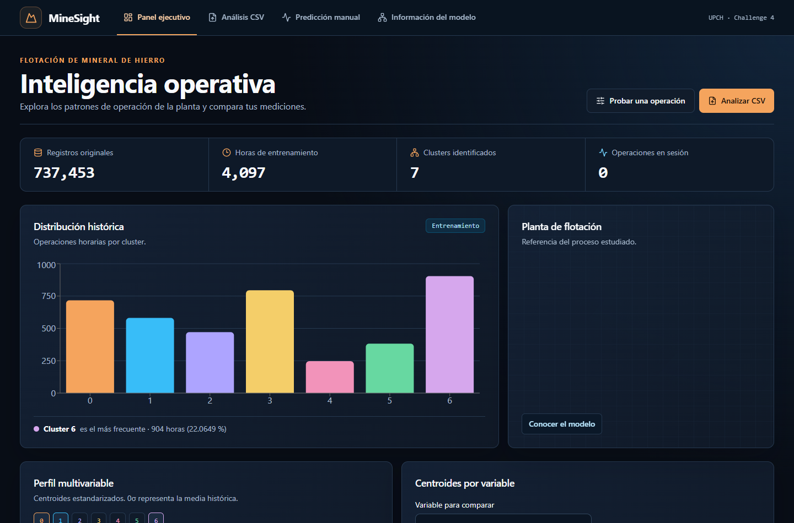
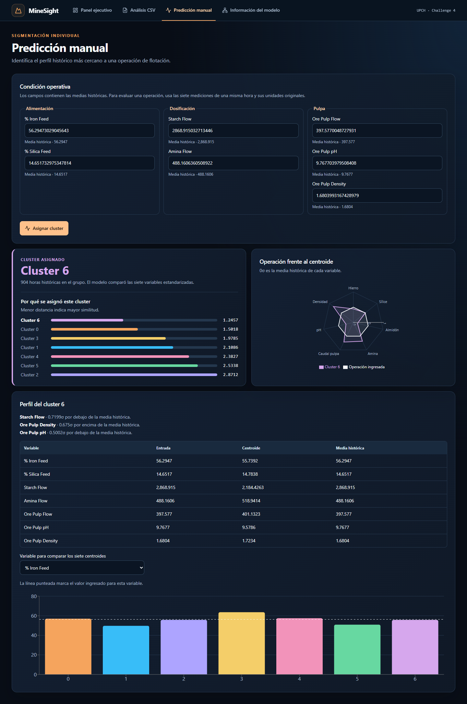
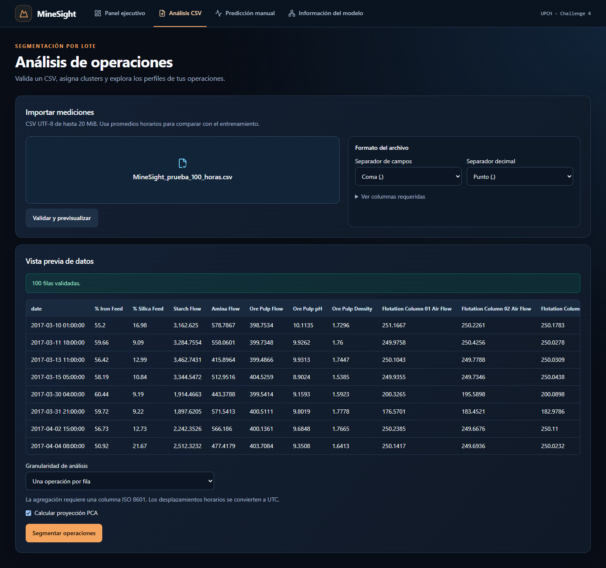
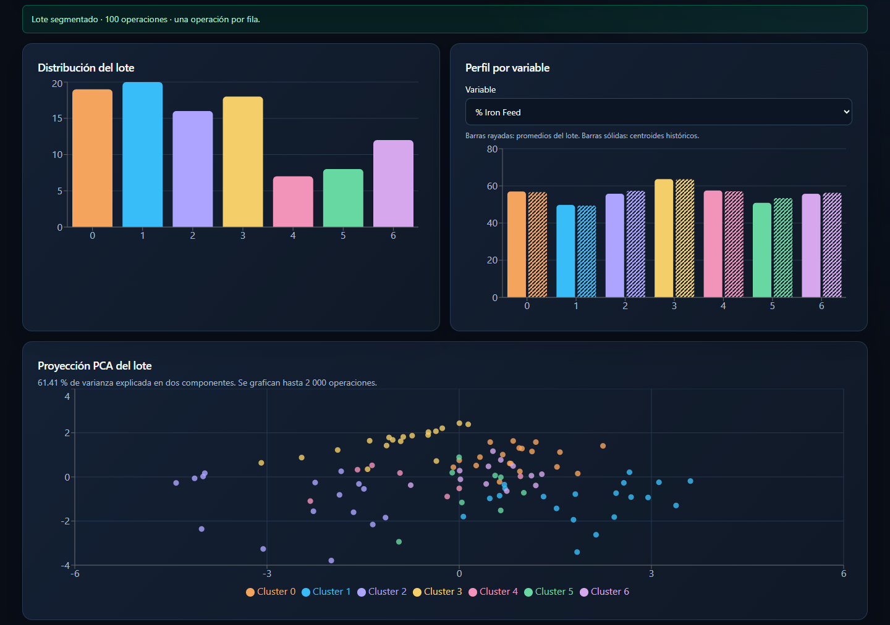
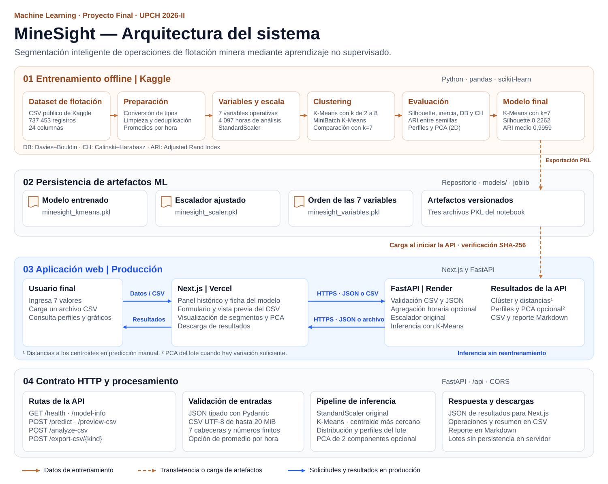

# MineSight · Segmentación operativa en flotación de hierro

Proyecto Final de Machine Learning · Universidad Peruana Cayetano Heredia · 2026-II

MineSight analiza la similitud entre condiciones operativas de flotación de hierro. La interfaz usa Next.js y FastAPI ejecuta el escalador y el K-Means originales.

[Demo en Vercel](https://minesight-vert.vercel.app/) · [API en Render](https://minesight-api.onrender.com/docs) · [Writeup (PDF)](docs/MineSight_WriteUp.pdf) · [Notebook actualizado](minesight-clustering-y-segmentaci-n-minera.ipynb) · [Notebook público en Kaggle (v1)](https://www.kaggle.com/code/marcoanccoquispe/minesight-clustering-y-segmentaci-n-minera)

## 1. Uso efectivo del modelo 

El conjunto [Quality Prediction in a Mining Process](https://www.kaggle.com/datasets/edumagalhaes/quality-prediction-in-a-mining-process) aporta 737 453 registros de flotación de hierro. El notebook elimina 1 171 duplicados y agrega por marca horaria, con 4 097 horas y siete variables de alimentación, reactivos y pulpa. Aplica StandardScaler y compara K-Means frente a MiniBatch K-Means. Los centroides permiten describir perfiles en las escalas originales y asignar nuevas horas por similitud aun cuando falten etiquetas operativas. Hierro y sílice del concentrado se analizan después del ajuste.

## 2. Dominio del problema 

El **metalurgista de procesos o analista de planta** necesita comparar el comportamiento de un turno con el historial cuando cambian varias condiciones a la vez. MineSight permite validar un lote, revisar las asignaciones y sus perfiles, e inspeccionar una hora con las siete entradas de la predicción manual. Las exportaciones apoyan el contraste con el laboratorio y la bitácora del turno.

## 3. Potencial de impacto 

Los siguientes valores proceden de las salidas guardadas del notebook. La diferencia relativa toma el clúster 0 como base y usa los caudales mostrados.

| Indicador | Cálculo sobre el historial | Lectura para planta |
|---|---|---|
| Frecuencia del clúster 6 | 100 × 904 / 4 097 = **22,06 %** de las horas analizadas | Referencia para comparar la mezcla de condiciones de un turno o lote posterior. |
| Brecha de caudal de reactivos, clúster 2 frente al 0 | 100 × (media del clúster 0 − media del clúster 2) / media del clúster 0. Almidón: 3 775,59 frente a 1 662,71 (**55,96 %**). Amina: 531,62 frente a 354,11 (**33,39 %**). | Señala qué grupos vale la pena revisar junto con la alimentación y las propiedades de la pulpa. |
| Caudal de reactivo relativo al de pulpa | Media horaria del caudal de reactivo del grupo / media horaria del caudal de pulpa del grupo, sobre las horas con datos de calidad. Clúster 0 → 2: almidón **9,415 → 4,185** y amina **1,326 → 0,891**. | Sirve para comparar flujos registrados entre grupos. La pulpa incluye agua y el caudal de solución no equivale a masa de reactivo activo. |
| Ley e impureza del concentrado | Media aritmética de los promedios horarios unidos al grupo. Clúster 0 → 2: Fe **65,27 % → 64,92 %** (−0,35 puntos porcentuales) y sílice **2,31 % → 2,42 %** (+0,11 puntos porcentuales), a partir de las medias redondeadas de la tabla de calidad. | Contextualiza los contrastes de caudal. Son asociaciones históricas entre condiciones diferentes. |

Las diferencias son asociaciones históricas entre horas con distinta alimentación, dosificación y estado de la pulpa. Las pruebas de la demo verifican segmentación y exportación. Para atribuir mejoras de dosificación, recuperación o costos harían falta validación metalúrgica, datos de reactivo activo y flujos másicos secos.

Para medir el tiempo de revisión, un piloto puede pedir a metalurgistas que identifiquen el perfil dominante de lotes comparables y entreguen una tabla verificable. Cada participante usaría ambos flujos en orden alternado, con los mismos criterios de exactitud y tiempos desde la apertura del archivo hasta la entrega. La fórmula prevista es 100 × (mediana de minutos con el flujo actual − mediana con MineSight) / mediana con el flujo actual. Falta observar el flujo actual con operadores y cronometrar esa tarea. Las pruebas técnicas de la API cubren otra unidad de medida.

## 4. Viabilidad del producto 

El barrido de k=2 a 8 seleccionó k=7 por silhouette. K-Means final usa `random_state=42` y `n_init=10`. La alternativa usa los mismos valores de k, semilla y reinicios, con minilotes de 256. Sobre las 4 097 horas, K-Means obtuvo silhouette **0,2262**, Davies–Bouldin **1,3357** y Calinski–Harabasz **917,3293**. MiniBatch K-Means obtuvo **0,1972**, **1,4672** y **865,4150**. El ARI medio de **0,9959** compara cuatro semillas contra la semilla 0 sobre el mismo conjunto.

La separación es limitada (silhouette 0,2262). El modelo cubre una planta y un periodo de 2017. La agregación por hora oculta transitorios y la estabilidad observada frente a semillas sobre el mismo historial deja abierta la estabilidad ante cambios de campaña, mineral y calibración. La asignación al centroide más cercano es exploratoria y carece de validación como diagnóstico, pronóstico de calidad o regla de dosificación.

Para un piloto en modo de observación, el metalurgista y el equipo de instrumentación deberían verificar el mapeo de etiquetas del historiador, las unidades, el sentido físico de los rangos, la cobertura horaria y el desfase con laboratorio. Conviene contrastar perfiles y distancias en ventanas temporales posteriores y revisar casos con especialistas antes de incorporar umbrales de alerta. El producto puede apoyar revisiones de turno e investigaciones de variabilidad por campaña. Una integración con el historiador requeriría un entorno autorizado para los datos operativos.

### Validación cronológica exploratoria

Con el CSV original se reprodujeron la deduplicación y los promedios horarios del notebook. Se ajustó una réplica de StandardScaler y K-Means (`k=7`, `random_state=42`, `n_init=10`) únicamente antes del 1 de julio de 2017. Las horas posteriores se asignaron a esos centroides congelados. El umbral de referencia es el percentil 95 de distancia al centroide más cercano en ajuste (2,7296).

| Periodo 2017 | Horas | Silhouette | Mediana de distancia | Sobre el umbral |
|---|---:|---:|---:|---:|
| 10 mar–30 jun, ajuste | 2 393 | 0,2314 | 1,4532 | 5,01 % |
| 1 jul–9 sep, evaluación | 1 704 | 0,2041 | 2,8267 | 52,17 % |

La distancia se mide en las siete variables estandarizadas. El aumento indica que muchas horas posteriores se parecen menos a los perfiles tempranos. Es un único corte de una planta, sin etiquetas de campaña ni validación de alarmas. Los identificadores de la réplica son propios de ese ajuste. Se conservan las métricas históricas y los PKL de producción.

Reproduce el corte desde la raíz, con las dependencias de Python instaladas y el CSV original disponible fuera del repositorio.

```bash
python -m docs.validation.temporal /ruta/al/MiningProcess_Flotation_Plant_Database.csv
```

## 5. Ejecución y comunicación 

La [demo en Vercel](https://minesight-vert.vercel.app/) permite probar **Predicción manual** con las medias precargadas (clúster 6 en la prueba documentada) y **Análisis CSV** con la [muestra de 100 horas](docs/screenshots/MineSight_prueba_100_horas.csv). El [Writeup final](docs/MineSight_WriteUp.pdf) reúne metodología, arquitectura, gráficos, capturas, contribuciones y enlaces a las fuentes. El notebook contiene el detalle de los experimentos y el código de entrenamiento. La API y Streamlit reutilizan la lógica de `services/`.

La Declaración de Proyecto Final Grupal de la UPCH acredita las funciones y los compromisos del equipo. Cuenta con las firmas de los cinco integrantes y está pendiente de la firma del docente. Se entrega directamente al docente como documento complementario.

### Demostración en producción

Capturas de Vercel del 27 de noviembre de 2026, con resultados de la API pública de Render.

| Panel ejecutivo | Predicción manual |
| --- | --- |
|  |  |

| Validación del CSV | Resultados del lote |
| --- | --- |
|  |  |

## Ejecutar en Windows

Requiere Python 3.12 y Node.js 22 o posterior. Abre dos terminales en la raíz del repositorio.

**Terminal 1 · FastAPI**

```powershell
py -3.12 -m venv .venv
.\.venv\Scripts\python.exe -m pip install -r backend\requirements.txt
cd backend
..\.venv\Scripts\python.exe -m uvicorn app.main:app --reload
```

**Terminal 2 · Next.js**

```powershell
cd frontend
npm.cmd ci
npm.cmd run dev
```

Abre [MineSight](http://localhost:3000). La [documentación interactiva de la API](http://127.0.0.1:8000/docs) muestra los endpoints y permite probarlos.

## Ejecutar en Linux

**Terminal 1**

```bash
python3.12 -m venv .venv
.venv/bin/python -m pip install -r backend/requirements.txt
cd backend
../.venv/bin/python -m uvicorn app.main:app --reload
```

**Terminal 2**

```bash
cd frontend
npm ci
npm run dev
```

## Configuración y solución de errores

- El frontend consulta `http://127.0.0.1:8000` por defecto. Configura `NEXT_PUBLIC_API_URL` en `frontend/.env.local` si cambias la dirección de la API. Después de editarla, reinicia el servidor de desarrollo o recompila la aplicación.
- Configura `MINESIGHT_CORS_ORIGINS` en el entorno del proceso de FastAPI para admitir orígenes adicionales separados por comas. El valor predeterminado admite solo `http://localhost:3000` y `http://127.0.0.1:3000`. Si Next.js cambia de puerto, incluye ese nuevo origen y reinicia FastAPI.
- Si PowerShell bloquea `npm.ps1`, usa `npm.cmd`. Si `py -3.12 --version` da error, instala Python 3.12 y vuelve a abrir la terminal antes de crear `.venv`.
- `npm run dev` inicia el entorno de desarrollo. Para levantar la compilación de producción ejecuta `npm run build` y luego `npm run start` dentro de `frontend/`. En PowerShell utiliza `npm.cmd`.
- Si la interfaz no conecta con FastAPI, abre [el endpoint de salud](http://127.0.0.1:8000/api/health) para confirmar el puerto y el estado del modelo.

## Despliegue público

### 1. Backend en Render

1. Inicia sesión en [Render](https://dashboard.render.com/). Selecciona **New → Blueprint**.
2. Conecta GitHub y, si aparece el selector de acceso, autoriza solo `Marco404-Dev/MineSight`. Selecciona ese repositorio y la rama `main`. Render cargará `render.yaml` desde la raíz.
3. Asigna un nombre al Blueprint y pulsa **Deploy Blueprint**. El servicio `minesight-api` se crea con el plan **Free**. Espera a que el despliegue esté activo y copia la URL HTTPS del servicio.
4. Abre su ruta `/api/health` y comprueba que devuelve `{"status":"ok","model_ready":true}`.

El Blueprint usa la raíz del repositorio porque FastAPI comparte `services/` y `models/` con Streamlit. Render selecciona Python 3.12 mediante `.python-version`. El servicio gratuito puede suspenderse por inactividad y tardar al atender la primera solicitud.

### 2. Frontend en Vercel

1. Inicia sesión en [Vercel](https://vercel.com/dashboard). Selecciona **Add New → Project** e importa `Marco404-Dev/MineSight`. Si no aparece, selecciona **Configure GitHub App** y autoriza solo ese repositorio.
2. En **Configure Project**, elige **Next.js** y pulsa **Edit** en **Root Directory** para seleccionar `frontend`. En **Environment Variables**, añade `NEXT_PUBLIC_API_URL` con la URL HTTPS de Render, sin `/api` al final.
3. Pulsa **Deploy**. En el proyecto de Vercel, copia el dominio de producción que aparece en **Domains**. Usa ese dominio para compartir el frontend.

### 3. Vincular los dominios y comprobar el despliegue

1. En Render, entra a `minesight-api` y abre **Environment → Add Environment Variable**. Crea `MINESIGHT_CORS_ORIGINS` con el origen HTTPS exacto de Vercel, sin ruta ni barra final. Guarda con **Save and deploy**. Puedes listar varios orígenes exactos separados por comas si usas varios dominios.
2. Abre el dominio de producción de Vercel en una ventana privada. Verifica que el panel muestre **4 097 horas de entrenamiento**.
3. En **Predicción manual**, pulsa **Asignar cluster** con las medias precargadas. El modelo original debe devolver **Cluster 6**.
4. En **Análisis CSV**, usa un archivo UTF-8 con las siete columnas requeridas. Comprueba la validación, la segmentación y la descarga de operaciones. Para el PCA, usa un lote con variación en al menos dos componentes. El navegador envía el archivo HTTPS directamente a Render y se conserva el límite de 20 MiB de la API.

### Actualizar desde GitHub

Sube o fusiona tus cambios en `main`. Con los proyectos conectados al repositorio, Vercel publica el frontend desde su rama de producción y Render despliega el backend cuando recibe un commit de `main`. Revisa los resultados en **Deployments** de Vercel y **Events** de Render. Si cambia la URL de la API, actualiza `NEXT_PUBLIC_API_URL` en Vercel y vuelve a desplegar el frontend. Si cambia el dominio del frontend, actualiza el origen permitido en Render.

## Arquitectura



[Diagrama editable en Draw.io](docs/architecture/MineSight_Architecture.drawio)

| Ruta | Responsabilidad |
| --- | --- |
| `frontend/src/app/` | Panel ejecutivo, análisis CSV, predicción manual e información del modelo con App Router |
| `frontend/src/components/` | Componentes de interfaz, gráficos Recharts, Motion e iconos Lucide |
| `backend/app/` | API FastAPI, validación Pydantic, segmentación CSV y exportaciones |
| `services/` | Inferencia, preprocesamiento y análisis compartidos con Streamlit |
| `models/` | Artefactos originales locales. Se comprueban por SHA-256 antes de deserializar |
| `backend/tests/` y `tests/` | Pruebas de la API y de la versión Streamlit |

### Flujo de datos

1. El navegador envía las variables o el CSV a FastAPI.
2. La API valida los campos y aplica, si se solicita, agregación por hora.
3. El StandardScaler original transforma las variables en el orden de entrenamiento. K-Means asigna el centroide más cercano.
4. La API devuelve distribuciones, centroides y perfiles. Para una operación también devuelve las distancias a los siete centroides. Son distancias en el espacio estandarizado, no probabilidades.

| Método | Endpoint | Función |
| --- | --- | --- |
| GET | `/api/health` | Estado de API y del modelo |
| GET | `/api/model-info` | Características, métricas, medias, centroides y distribución histórica |
| POST | `/api/predict` | Segmentación individual mediante JSON |
| POST | `/api/preview-csv` | Validación y vista previa mediante multipart |
| POST | `/api/analyze-csv` | Segmentación por lote, distribución, perfiles y PCA opcional |
| POST | `/api/export-csv/{kind}` | Exporta `operations`, `summary` o `report` |

El CSV admite UTF-8, un máximo de 20 MiB y las siete cabeceras exactas que aparecen en la interfaz. La vista previa muestra hasta ocho filas de entrada y cincuenta filas segmentadas. La descarga contiene todas las operaciones. Las exportaciones reutilizan el archivo y los parámetros seleccionados, y vuelven a ejecutar el pipeline sin guardar lotes en el servidor. El PCA se ajusta con el lote completo y se muestran hasta 2 000 puntos. Si el lote tiene variación insuficiente, la interfaz explica el motivo. La barra de progreso mide la transferencia del archivo. El cálculo en FastAPI se muestra como un estado de espera.

## Pruebas

[GitHub Actions](https://github.com/Marco404-Dev/MineSight/actions/workflows/verificacion.yml) ejecuta las pruebas de FastAPI, del pipeline y de Streamlit con Python 3.12. Compila Next.js con Node.js 22 y Webpack en cada push y pull request dirigido a `main`.

En la revisión local pasaron 13 pruebas (5 de FastAPI y 8 de pipeline y Streamlit) y la compilación de producción con Webpack. Ejecuta estos comandos desde la raíz con el entorno de Python 3.12 activado.

```bash
python -m pip install -r requirements.txt -r backend/requirements-dev.txt
python -m unittest discover -s backend/tests -v
python -m unittest discover -s tests -v
npm --prefix frontend ci
npm --prefix frontend run build -- --webpack
```

La prueba de paridad compara FastAPI con el pipeline de Streamlit usando las medias y los centroides del modelo. En producción, `/api/health` reportó el modelo disponible. Las medias precargadas dieron el clúster 6. El CSV de 100 horas pasó la validación, devolvió 100 operaciones y 100 puntos PCA y permitió descargar las operaciones. La muestra procede de [una versión pública agregada por hora](https://github.com/baiheng2012/mine-ai-platform/blob/main/data/README.md).

## Streamlit

La versión anterior sigue disponible en `app.py`. Instala las dependencias de `requirements.txt` de la raíz y ejecuta `python -m streamlit run app.py` con ese entorno. La ilustración de flotación es un SVG original reutilizado en ambas interfaces.
